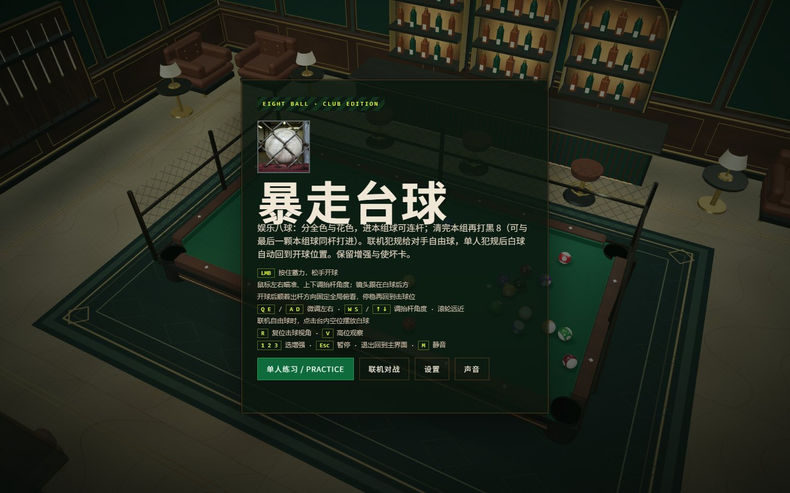
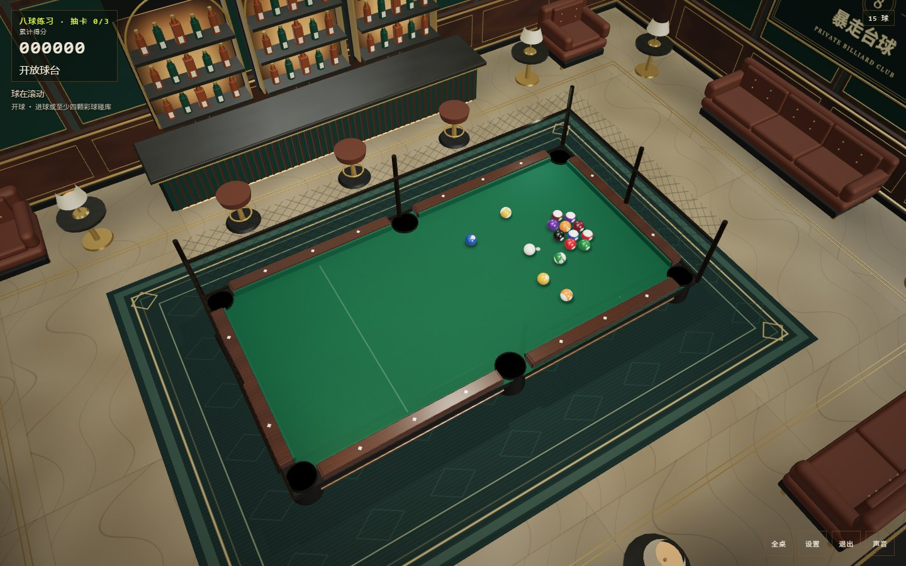

# 暴走台球 · 网页版

在一间带围笼的 3D 台球俱乐部中练习八球。瞄准、蓄力和控制抬杆角度，配合增强与使坏卡完成一局。

本仓库是网页版；小游戏版本位于 [iron-cage-minigame](https://github.com/susyimes/iron-cage-minigame-open)。

## 游戏画面

2026-10-12 本地单人练习实机截图。





## 已实现玩法

- 娱乐化八球：分全色与花色，合法进本组球可连杆，清完本组后打黑 8。
- 单人练习与源码中的双人房间模式，共用裁判规则；联机犯规给对手自由球。
- 蓄力、瞄准、可调抬杆角度、自由球摆位、击球视角和全桌观察。
- 增强与使坏卡；单人每合法进 3 球抽卡，联机每累计 6 杆抽卡。
- 可手动选择画质，支持触屏、声音设置与再开一局。

| 操作 | 输入 |
| --- | --- |
| 瞄准 / 抬杆 | 鼠标移动；Q、E / A、D 微调方向；W、S 调抬杆 |
| 蓄力击球 | 按住鼠标左键或空格，松开出杆 |
| 观察 | 右键拖动；滚轮缩放；R 重置；V 全桌 |
| 卡牌 / 菜单 | 1、2、3 / Esc |
| 触屏 | 单指瞄准、双指转镜头、捏合缩放及界面按钮 |

规则与同步见 [docs/NETWORK_SYNC.md](docs/NETWORK_SYNC.md)。这是娱乐化规则，不是对完整赛事规则的认证实现。

## 本地运行

本次使用 Node.js 24.15.0 和 npm。

```sh
npm ci --ignore-scripts
npm run dev -w client -- --host 127.0.0.1
```

打开 <http://127.0.0.1:43153/>，选择「单人练习」。单人模式不需要启动联机服务器。

需要本机联机测试时，另开终端执行 `npm run dev:server`，服务器默认端口为 43154。用两个本机标签页输入同一房间码测试。源码已提供房间与同步流程，但本次只验证单人入口与击球，没有验证线上匹配、外网连接或长局同步。

```sh
npm run build
npm run preview -- --host 127.0.0.1
```

生产构建输出为 `client/dist/`。`npm start` 可由现有服务器同时提供构建后的静态页面和 WebSocket。不要把仓库里的历史部署地址视为当前可用性承诺。

2026-10-12 已完成锁定安装、单人启动、一次开球和生产构建。项目另提供 `npm run typecheck`、`npm run test:online`、`npm run test:visual`；本次未重新跑完整自动测试集。

## 技术栈与限制

TypeScript、Three.js、Vite；Node.js + `ws` 提供房间服务。`client/src/game/` 为球台、物理、规则与卡牌，`server/src/` 为房间和同步，`docs/` 保存规则与开发记录。

本作是娱乐八球原型，不含账号体系、防作弊认证或排位服务。多人菜单中的暂停不会让对局停止。移动设备性能与外网多人稳定性需继续验证；构建有前端大包提示。

## 素材与许可状态

球台、房间、球号、材质与部分效果由 Three.js 和程序化纹理构建，效果声使用 Web Audio。页面引用 Google Fonts 中的 IBM Plex Mono、Noto Sans SC、Oswald，保留字体各自条款。

维护者确认 `client/public/emblem.jpg` 与 `client/public/icons/*.png` 为可商业使用和分发的生成图像。其素材范围单独记于 [ASSETS.md](ASSETS.md)。原 `jazz.mp3` 及历史 `club.mp3` 的音乐许可未确认，公开文件和 Git 历史均不包含这些录音；游戏直接使用已有 Web Audio 合成环境底声和效果声，不请求缺失音乐。截图画面保持有效。

## 许可证

本项目自有代码采用 [MIT 许可证](LICENSE)。素材范围与来源见 [ASSETS.md](ASSETS.md)；第三方依赖及素材保留原有条款，不因代码 MIT 而被重新授权。

本仓库从已清理的当前文件建立独立 Git 历史；原私库与原工作区保留。

2026-10-13 清理公开版验证：npm run build 通过，真实浏览器单人开球通过；没有缺失资源、旧音乐请求或页面异常。原实机截图中的图像资源仍随公开版保留。


### Languages / 语言

English and Simplified Chinese are available from the title screen and Settings
(English / 简体中文). On first launch the browser's highest-priority supported language is used:
Chinese (`zh-*`) selects 简体中文 and English (`en-*`) selects English.
If neither appears in the preference list, English is the fallback. The choice is
saved locally under `iron-cage-language` when browser storage is available.
Switching updates the current menus, HUD, notices and offered cards without
resetting the match, camera, score, upgrades or online connection. The same
selection works in the static itch build; online availability depends on hosting.
Legacy Chinese rules and server messages are translated at explicit client
presentation sites; protocol fields, names, card IDs and save formats stay intact.
The club wall crest and image assets retain their original branding.
Run `npm run test:i18n` for preference, storage, catalog and message checks.
